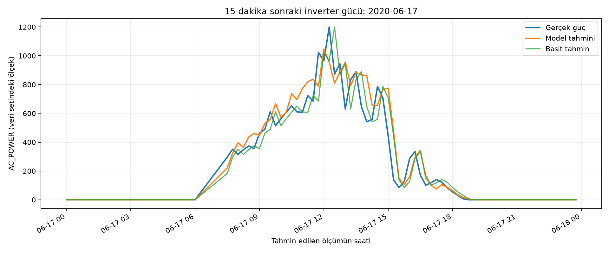

# Güneş Enerjisi Santralinde İnverter Güç Tahmini

Bir güneş enerjisi santralindeki inverterin **15 dakika sonraki AC gücünü** tahmin eden veri madenciliği projesi. Plant 1 üretim ve hava sensörü verileri birleştirilir; makine öğrenmesi modeli, “güç aynı kalır” diyen basit tahminle karşılaştırılır.

## Sonuç

Son test bölümünde (624 örnek) Random Forest modelinin ortalama mutlak hatası **48,56**, basit tahminin hatası **50,13** oldu. Daha küçük hata daha iyi tahmin demektir. Gece sıfır değerleri sonucu kolaylaştırdığı için güneş ışınımı bulunan saatler ayrıca değerlendirildi: model **87,32**, basit tahmin **90,15**.



Model günlük genel eğilimi izliyor; öğle saatlerindeki bazı ani değişimleri kaçırıyor. Ayrıntılı yöntem ve yorum için [proje özetine](reports/proje_ozeti.md), ilk keşif çalışması için [ilk deney notuna](reports/ilk_deney.md) bakılabilir.

## Kullanılan yöntem

1. Plant 1 içindeki bir inverterin üretim kayıtları, aynı saatteki hava sensörü kayıtlarıyla eşleştirilir.
2. Her kayda **tam 15 dakika sonraki** `AC_POWER` değeri hedef olarak eklenir. Hedef değer model girdisi olarak kullanılmaz.
3. İki özellik grubu denenir: anlık ölçümler; anlık ölçümlere ek olarak 15/30 dakika önceki güç ve ışınım ölçümleri.
4. Veri zaman sırasıyla yaklaşık %60 öğrenme, %20 doğrulama ve %20 son test olarak ayrılır. Model seçimi yalnızca doğrulama verisiyle yapılır.
5. Seçilen model yeniden eğitilir ve son testte basit tahminle **ortalama mutlak hata (MAE)** üzerinden karşılaştırılır.

Anlık ölçümler doğrulamada daha iyi sonuç verdiği için son model bu özellikleri kullanır: mevcut AC güç, ışınım, ortam sıcaklığı, panel sıcaklığı, saat ve dakika. Gelecek hava ölçümleri kullanılmaz.

## Kendi bilgisayarında çalıştırma

Python **3.14.8** ve Windows PowerShell ile çalıştırıldı. Proje klasöründe şu adımları uygula:

```powershell
python -m venv .venv
.\.venv\Scripts\python.exe -m pip install -r requirements.txt
```

[Kaggle veri setini](https://www.kaggle.com/datasets/anikannal/solar-power-generation-data) indir. ZIP içindeki şu iki dosyayı `data/raw/` klasörüne koy:

- `Plant_1_Generation_Data.csv`
- `Plant_1_Weather_Sensor_Data.csv`

Ardından ana deneyi çalıştır:

```powershell
.\.venv\Scripts\python.exe src\train_model.py
```

Komut doğrulama ve test hatalarını terminale yazar; son test gününün grafiğini `reports/figures/final_test_last_day.png` konumuna kaydeder. Veri dosyalarının ilk kontrolünü görmek istersen `src/inspect_data.py` çalıştırabilirsin.

## Dosya yapısı

| Yol | İçerik |
| --- | --- |
| `src/train_model.py` | Ana veri hazırlama, model seçimi, test ve grafik |
| `src/inspect_data.py` | İlk veri incelemesi ve keşif deneyi |
| `data/raw/README.md` | Ham veriyi indirme yönergesi |
| `reports/proje_ozeti.md` | Ders için kısa yöntem ve sonuç anlatımı |
| `reports/figures/` | Oluşturulan sonuç grafikleri |

Ham CSV dosyaları ve yerel Python ortamı `.gitignore` ile GitHub deposunun dışında tutulur.

## Kapsam ve sınırlamalar

Veri 15 Mayıs–17 Haziran 2020 döneminden ve tek bir inverterden alınmıştır. Farklı mevsimler veya diğer inverterler için aynı başarı garanti edilemez. Tahmin edilen değişken enerji miktarı değil, `AC_POWER` güç ölçümüdür. Veri setindeki birim doğrulanmadığı için hata değerleri kW olarak adlandırılmaz.

Veri kaynağı: [Solar Power Generation Data](https://www.kaggle.com/datasets/anikannal/solar-power-generation-data).
