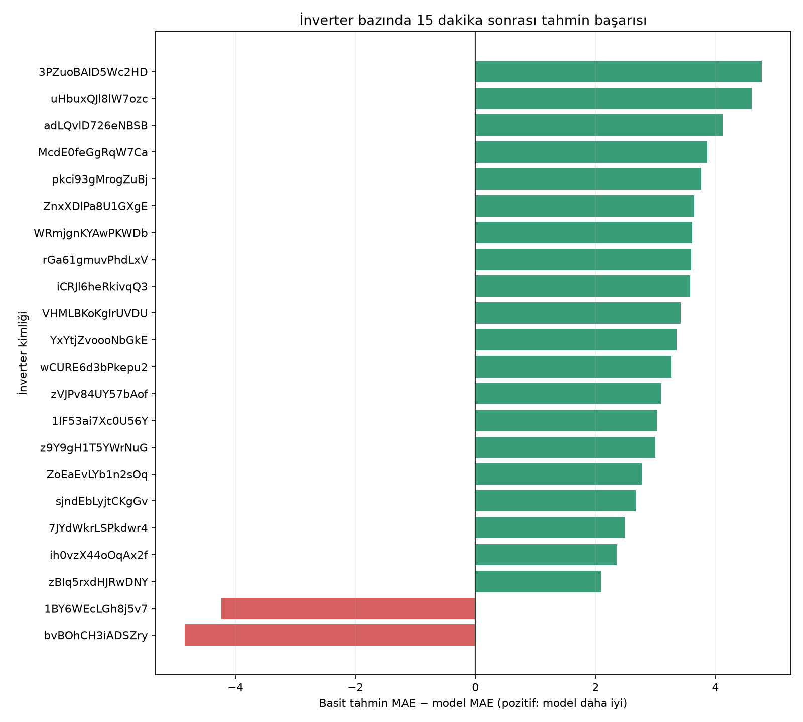
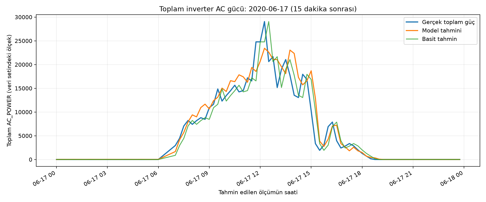

# Güneş Enerjisi Santralinde İnverter Güç Tahmini

Bir güneş enerjisi santralindeki **22 inverterin 15 dakika sonraki AC gücünü** tahmin eden veri madenciliği projesi. Plant 1 üretim ve hava sensörü verileri birleştirilir; iki makine öğrenmesi modeli, “güç aynı kalır” diyen basit tahminle karşılaştırılır.

## Sonuç

Son test bölümünde (13.860 örnek) seçilen **Gradient Boosting** modelinin ortalama mutlak hatası **51,92**, basit tahminin hatası **54,56** oldu. Daha küçük hata daha iyi tahmin demektir. Güneş ışınımı bulunan saatlerde model **92,30**, basit tahmin **97,38** hata verdi. Gücün hızlı değiştiği 1.174 örnekte model **263,54**, basit tahmin **293,90** hata verdi. Model, 22 inverterin **20’sinde** basit tahminden daha iyiydi; 2’sinde daha kötüydü.



Grafikte sağdaki yeşil çubuklar modelin daha iyi olduğu inverterleri, soldaki kırmızı çubuklar daha kötü olduğu inverterleri gösterir. İnverter başına sayılar [CSV tablosunda](reports/inverter_errors.csv), tüm deney ölçüleri [JSON dosyasında](reports/plant_metrics.json) bulunur. Ayrıntılı yöntem ve yorum için [proje özetine](reports/proje_ozeti.md) bakılabilir.

“Hızlı değişim” sınırı, öğrenme verisindeki 15 dakikalık mutlak güç değişimlerinin üst %10’undan hesaplandı (**189,31**). Bu grup yalnızca sonradan hata analizi için kullanılır; gerçekleşecek değişim modele önceden verilmez.

22 inverterin aynı saatteki tahminleri toplanarak **toplam inverter AC gücü** de incelendi. Son testte 630 zaman noktası için toplam güç MAE değeri basit tahminde **1.153,82**, modelde **1.097,90** oldu. Bu değerler 22 gücün toplamına ait olduğu için tek inverter hata değerleriyle aynı ölçekte değildir.



## Etkileşimli sonuç ekranı

[Dashboard'u aç](dashboard/index.html) bağlantısıyla sonuçları tarayıcıda inceleyebilirsin. Ekranda toplam güç grafiğinin model/basit tahmin çizgileri açılıp kapatılabilir; bir inverter seçildiğinde onun hata değerleri gösterilir. **Canlı santral verisi değildir:** yalnızca son test döneminin kayıtlı sonuçlarını gösterir. Ek bir web paketi veya sunucu gerekmez.

[Tahmin simülasyonunu aç](dashboard/simulation.html) bağlantısı, son test gününün 07.00–23.45 arasındaki ardışık kayıtlarını hızlandırılmış biçimde oynatır. Başlat, duraklat, tek adım ilerlet, başa dön ve hız seçimi vardır. Her adımda mevcut ölçüm ile **15 dakika sonrası tahmin** gösterilir; gerçek güç ve o tahminin hatası ancak sonraki adımda açılır. Böylece sunumda tahmin süreci izlenebilir. Bu ekran da gerçek zamanlı santral bağlantısı kullanmaz; Python modelinin önceden hesapladığı test tahminlerini oynatır.

## Tahmin aralığı: tek sayının yanına belirsizlik

22 inverterin **toplam 15 dakika sonrası AC gücü** için model tahmininin yanında alt ve üst sınır gösterilir. Sınırlar, doğrulama dönemindeki toplam güç tahmin hatalarının **mevcut güç düzeyine göre %80 diliminden** hesaplanır; son test sonuçları sınır seçmek için kullanılmaz. [Sonuç grafiğindeki](dashboard/index.html) turuncu alanı açıp kapatabilir, [analiz ekranında](dashboard/analysis.html) kapsama oranını görebilirsin.

Ayrılmış son testte 630 zaman noktasının **%73,3'ünde** gerçek güç aralıkta kaldı; güneş ışınımı bulunan 353 noktada oran **%81,6** oldu. Hedef %80 olsa da tüm zamanlarda buna ulaşılamadı. Ortalama aralık genişliği toplam güç ölçeğinde **4.174,88**; gündüz **7.430,70**. Aralık kesin sınır değildir; sonraki ölçümlerin mutlaka içinde kalacağını garanti etmez. [Son gün grafiği](reports/figures/plant_interval_last_day.png), [15 dakikalık aralık tablosu](reports/plant_prediction_intervals.csv) ve [ölçüler](reports/interval_metrics.json) incelenebilir.

## Yerel cihaz ölçüm akışı demosu

Statik simülasyondan ayrı olarak [yerel akış ekranı](dashboard/live.html) da bulunur. Bu ekranda 17 Haziran 2020 tarihli **ham ölçümler**, inverter/hava sensörü paketi biçiminde yerel sunucunun `POST /api/telemetry` adresine sırayla gönderilir. Python sunucusu **her paket geldiğinde kayıtlı modeli çalıştırır** ve 15 dakika sonrası tahmini ve aralığını üretir. Gerçek güç ve büyük sapma uyarısı yalnızca o saatin ölçüm paketi geldikten sonra açılır. Gündüz ani düşüş uyarısı için yalnızca ardışık son 15 dakika ölçümleri kullanılır. Bu bir **tarihsel cihaz akışı simülasyonudur**; gerçek santrale bağlı değildir.

Önce ham CSV dosyalarını yerleştirip `src/plant_model.py` komutunu bir kez çalıştır. Bu işlem `models/` altında tahmin modeli, risk modeli ve aralık kurallarını kaydeder. Ardından proje klasöründeyken:

```powershell
.\.venv\Scripts\python.exe src\live_demo.py
```

Terminalde gösterilen **http://127.0.0.1:8765/** adresini aç, **Akışı başlat** veya **Tek ölçüm gönder** düğmesini kullan. Duraklatma, başa dönme ve hız seçimi vardır. Sunucuyu durdurmak için terminalde `Ctrl+C` kullan. `dashboard/live.html` dosyasını doğrudan çift tıklayarak açmak yerine bu adresi kullan; model tarayıcıda değil Python sunucusunda çalışır. `models/` dosyaları Git'e eklenmez; GitHub'dan indiren biri aynı komutla yeniden üretir. Sunucu yalnızca bu bilgisayardaki `127.0.0.1` arayüzünde dinler.

Bu haliyle yalnızca aynı bilgisayardaki bir ağ geçidi, 22 inverterin tam ölçüm paketini bu girişe gönderebilir. Fiziksel Arduino/ESP32, MQTT, dış ağ bağlantısı ve üretim güvenliği kurulumu yapılmadı; bunlar ayrı entegrasyon aşamalarıdır.

[Model analizini aç](dashboard/analysis.html) bağlantısı, son testteki hatayı hedef saatine ve seçilen invertere göre karşılaştırır. 06.00–18.00 hedef saatlerinde modelin en yüksek ortalama hatası **14.00'te 209,81** oldu; o saatte basit tahminin hatası **196,69** idi. Genel toplamda model daha iyi olsa da her saatte üstün değildir. [Saatlik hata grafiği](reports/figures/hourly_errors.png), [saatlik CSV](reports/hourly_errors.csv) ve [inverter-saat CSV'si](reports/inverter_hourly_errors.csv) ayrıntıları gösterir.

Girdi etkisi, **gündüz doğrulama verisinde** her girdi grubunun değerleri karıştırılarak ölçüldü. Karıştırınca model hatası en çok **güneş ışınımında +112,86** ve **anlık AC güçte +82,08** arttı. Bu, modelin bu bilgilere dayandığını gösterir; neden-sonuç kanıtı değildir. [Girdi etkisi grafiği](reports/figures/feature_importance.png) ve [CSV tablosu](reports/feature_importance.csv) diğer girdileri de içerir.

Simülasyonda gerçekleşen toplam güç ile tahmin arasındaki fark, **6.055,28** değerini aşınca “Büyük sapma” uyarısı görünür. Eşik, son teste bakılmadan **doğrulama dönemindeki toplam güç mutlak hatalarının %95 sınırından** alındı. Son testteki 630 zaman noktasının 29'unda, oynatılan son günün 4 noktasında eşik aşıldı. Bu bir **inceleme işaretidir**; veri setinde arıza etiketi olmadığı için arıza teşhisi sayılmaz. Toplam güç eşiği, tek inverter MAE değeriyle aynı ölçekte değildir.

## Operasyon masası: risk, filo kıyası, olay kaydı

[Operasyon masasını aç](dashboard/operations.html) bağlantısı üç özelliği birleştirir:

1. **Ani düşüş riski:** Mevcut güç, ışınım ve son 15 dakikadaki değişimleri kullanan ayrı bir sınıflandırma modeli, bir inverterin sonraki 15 dakikada sert güç düşüşü yaşayıp yaşamayacağını işaretler. Sert düşüş sınırı yalnızca öğrenme verisindeki pozitif düşüşlerin üst %10'undan (**278,48**) gelir. Uyarı puanı eşiği doğrulama bölümünde F1 değerine göre seçilir. Gündüz son testte **7.744** kaydın **385** tanesinde sert düşüş vardı. Modelin **623** uyarısının **186** tanesi isabetliydi: **%29,9 isabet (precision)** ve gerçek düşüşlerin **%48,3'ünü yakalama (recall)**. Rastgele bir kaydın düşüş olma oranı **%5,0** idi. Risk puanı kesin olasılık değildir. [Değerlendirme grafiği](reports/figures/ramp_precision_recall.png) ve [sayısal rapor](reports/operations_metrics.json) bu sınırı görünür kılar.
2. **İnverter kıyas radarı:** Her inverterin gücü, yalnızca öğrenme dönemindeki kendi referans gücüne bölünür; aynı andaki filo medyanıyla karşılaştırılır. Güçlü üretim anlarında medyanın %70'inin altında en az **4 ardışık ölçüm** kalan cihazlar inceleme kaydına girer. Son testte **14 Haziran 11.00–14.15** aralığında iki inverter için **210 dakikalık** ortak ayrışma bulundu. [Olay grafiği](reports/figures/peer_case.png), [inverter özeti](reports/peer_summary.csv) ve [bölüm tablosu](reports/peer_episodes.csv) ayrıntıları gösterir. Bu, neden veya arıza teşhisi değildir.
3. **Operatör olay kaydı:** Son testteki **29 büyük tahmin sapması** ile aynı anda gerçekleşen iki inverterlik **1 filo kıyası olayı** bir araya getirilir. Her kayıtta zaman, ölçülen/tahmin edilen güç veya ilgili inverterler bulunur. [Olayları JSON olarak gör](reports/operator_events.json). Simülasyonda risk uyarısı tahmin anında, gerçekleşen olay ise gerçek ölçüm açıldıktan sonra görünür.

[Operasyon ekranındaki](dashboard/operations.html) **inceleme sırası**, filo medyanının belirgin altında geçirilen uzun olayların toplam süresine göre 22 inverteri sıralar. 14 Haziran 2020'de iki inverterin her biri **210 dakika** ayrıştığı için ilk sıradadır. Bir inverter seçilince ilgili günün 15 dakikalık filo oranı grafiği, düşük ölçümler, toplam olay süresi ve modelin o inverterdeki test hatası gösterilir. Kısa sapmalar “İzle” grubundadır; sonuçlar bakım önerisi veya arıza teşhisi değildir. [Sıralama CSV'si](reports/inverter_priority.csv) tekrar üretilebilir.

`src/plant_model.py` çalıştırıldığında `dashboard/data.js` ve `dashboard/operations_data.js` dosyaları da yeniden üretilir. Bu dosyalarda ham CSV kayıtları yerine özet sonuçlar, risk işaretleri ve olay kayıtları bulunur. GitHub'a yüklendikten sonra bu statik ekran [GitHub Pages](https://docs.github.com/en/pages/getting-started-with-github-pages/what-is-github-pages) ile de yayımlanabilir; yayımlama şu anda yapılmamıştır.

## Kullanılan yöntem

1. Plant 1 içindeki 22 inverterin üretim kayıtları, aynı saatteki hava sensörü kayıtlarıyla eşleştirilir.
2. Her kayda **tam 15 dakika sonraki** `AC_POWER` değeri hedef olarak eklenir. Hedef değer model girdisi olarak kullanılmaz.
3. Anlık güç, ışınım, sıcaklık, saat ve inverter kimliği kullanılarak Random Forest ve Gradient Boosting modelleri denenir.
4. Veri **tarih ve saat bazında** yaklaşık %60 öğrenme, %20 doğrulama ve %20 son test olarak ayrılır. Böylece aynı saat farklı inverterlerde iki bölüme dağılmaz. Model seçimi yalnızca doğrulama verisiyle yapılır.
5. Seçilen model yeniden eğitilir; son testte hem genel hem de inverter bazındaki sonuçlar basit tahminle **ortalama mutlak hata (MAE)** üzerinden karşılaştırılır.

Doğrulama hataları: basit tahmin **66,45**, Random Forest **60,49**, Gradient Boosting **59,61**. Son model yalnızca tahmin anında bilinen ölçümleri kullanır; gelecek hava ölçümleri kullanılmaz. Fiziksel olarak mümkün olmayan negatif güç tahminleri sıfıra çekilir; sonuçlar bu düzeltmeden sonra hesaplanır.

## Kendi bilgisayarında çalıştırma

Python **3.14.8** ve Windows PowerShell ile çalıştırıldı. Proje klasöründe şu adımları uygula:

```powershell
python -m venv .venv
.\.venv\Scripts\python.exe -m pip install -r requirements.txt
```

[Kaggle veri setini](https://www.kaggle.com/datasets/anikannal/solar-power-generation-data) indir. ZIP içindeki şu iki dosyayı `data/raw/` klasörüne koy:

- `Plant_1_Generation_Data.csv`
- `Plant_1_Weather_Sensor_Data.csv`

Ardından tüm santral deneyini çalıştır:

```powershell
.\.venv\Scripts\python.exe src\plant_model.py
```

Komut doğrulama ve test sonuçlarını terminale yazar; tahmin, risk ve filo kıyası raporlarını, `reports/figures/` altındaki grafikleri ve iki dashboard veri dosyasını oluşturur. Önceki tek inverter deneyini görmek istersen `src/train_model.py`, ilk veri kontrolü için `src/inspect_data.py` çalıştırabilirsin.

Yerel akış ekranı için aynı komut gerekli kayıtlı modelleri ve aralık kurallarını da oluşturur. Sonra `src/live_demo.py` komutunu çalıştırıp yukarıdaki yerel adresi açabilirsin.

Zaman aralığı ve filo olayı kurallarını kontrol etmek için:

```powershell
.\.venv\Scripts\python.exe -m unittest discover -s tests -v
```

## Dosya yapısı

| Yol | İçerik |
| --- | --- |
| `src/plant_model.py` | 22 inverter için model karşılaştırma, test ve hata analizi |
| `src/operations_model.py` | Ani düşüş riski, inverter kıyası, inceleme sırası ve olay kaydı |
| `src/uncertainty.py` | Doğrulama hatalarından santral toplam güç aralığı ve son test kapsaması |
| `src/live_demo.py` | Yerel HTTP ölçüm alıcısı, anlık model çalıştırma ve tarihsel cihaz akışı |
| `src/train_model.py` | Tek inverterli ilk geliştirme deneyi |
| `src/inspect_data.py` | İlk veri incelemesi ve keşif deneyi |
| `tests/test_operations.py` | Geçmiş ölçüm ve kesintisiz filo olayı kontrolleri |
| `tests/test_live_demo.py` | Akışın zaman sırası, gelecek veriyi gizleme ve paket doğrulama kontrolleri |
| `tests/test_uncertainty_priority.py` | Aralık sınırları ve inverter inceleme sırası kontrolleri |
| `dashboard/` | Sonuç, model analizi, simülasyon ve operasyon masası |
| `index.html` | Statik site ana sayfası; dashboard'a yönlendirir |
| `data/raw/README.md` | Ham veriyi indirme yönergesi |
| `reports/proje_ozeti.md` | Ders için kısa yöntem ve sonuç anlatımı |
| `reports/inverter_errors.csv` | İnverter başına test hataları |
| `reports/hourly_errors.csv` | Hedef saate göre test hataları |
| `reports/inverter_hourly_errors.csv` | İnverter ve hedef saate göre test hataları |
| `reports/feature_importance.csv` | Gündüz doğrulama verisinde girdi grubu etkisi |
| `reports/operations_metrics.json` | Ani düşüş modeli ve filo kıyası sonuçları |
| `reports/ramp_risk_predictions.csv` | Son testteki gündüz risk tahminleri ve gerçekleşen düşüşler |
| `reports/peer_summary.csv`, `reports/peer_episodes.csv` | İnverter kıyası ve uzun düşük üretim bölümleri |
| `reports/operator_events.json` | Tarihsel operatör olay kayıtları |
| `reports/plant_metrics.json` | Tekrar üretilebilir deney sonuçları |
| `reports/interval_metrics.json`, `reports/plant_prediction_intervals.csv` | Tahmin aralığı kapsaması ve her test zaman noktası için sınırlar |
| `reports/inverter_priority.csv` | Şeffaf inverter inceleme sırası ve dayandığı süreler |
| `reports/figures/` | Oluşturulan sonuç grafikleri |

Ham CSV dosyaları ve yerel Python ortamı `.gitignore` ile GitHub deposunun dışında tutulur.

## Kapsam ve sınırlamalar

Veri 15 Mayıs–17 Haziran 2020 döneminden ve yalnızca Plant 1 santralinden alınmıştır. Farklı mevsimler veya başka santraller için aynı başarı garanti edilemez. İki inverterde model basit tahminden daha kötü sonuç vermiştir; bu durum ayrı inceleme gerektirir. Tahmin edilen değişken enerji miktarı değil, `AC_POWER` güç ölçümüdür. Veri setindeki birim doğrulanmadığı için hata değerleri kW olarak adlandırılmaz.

Ani düşüş modeli hatalı uyarılar verebilir ve gerçek düşüşlerin bir bölümünü kaçırır. Filo kıyası, çalışma koşulları aynı santral içinde benzer varsayımıyla yapılır; inverterlerin kurulu kapasiteleri ve arıza etiketleri bilinmez. Olay kayıtları gözlenen veri örüntülerini düzenler, kök neden belirlemez.

Tahmin aralığı doğrulama döneminin hatalarından türetilmiştir ve zamana bağlı veri değişiminde garanti vermez. Son testte genel kapsama hedefin altında kalmıştır. İnverter inceleme sırası, yalnızca göreli üretim ve süreye dayalı bir operatör önceliğidir.

Veri kaynağı: [Solar Power Generation Data](https://www.kaggle.com/datasets/anikannal/solar-power-generation-data).
