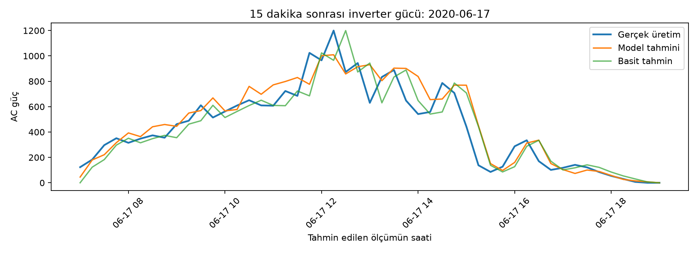

# İlk deney: tek model ve zaman sıralı test

Projenin ilk aşamasında Plant 1 içinden `bvBOhCH3iADSZry` kimlikli inverter seçildi. Aynı zamandaki inverter ve ortam ölçümleri birleştirildi. Her kayıt için tam 15 dakika sonraki AC güç hedef olarak eşleştirildi. İlk %80 zaman sırasıyla eğitim, son %20 test için kullanıldı.

| Test grubu | Basit tahminin ortalama mutlak hatası | Random Forest ortalama mutlak hatası |
| --- | ---: | ---: |
| Tüm saatler (629 kayıt) | 50,16 | 48,94 |
| Işınım olan saatler (352 kayıt) | 89,63 | 87,45 |

Basit tahmin, gelecek gücün şu anki güçle aynı kalacağını varsayar. İlk model bu tahminden biraz daha iyi sonuç verdi. Gece sıfır üretim sık olduğu için gündüz hatası ayrıca raporlandı. Hata değerleri veri setindeki `AC_POWER` ölçeğindedir.

Grafikte model genel günlük değişimi izliyor, ancak ani yükseliş ve düşüşleri kaçırıyor. Sonraki deneyde model seçimi için ayrı bir doğrulama bölümü kullanıldı. Bu nedenle iki deneyin test sayıları ve sonuçları doğrudan karşılaştırılmamalıdır.

İlk deneyin kodu: [`src/inspect_data.py`](../src/inspect_data.py).
